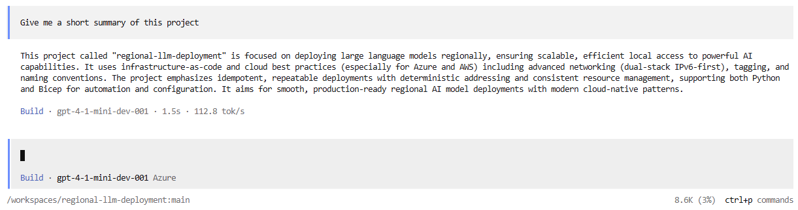

# Regional LLM deployment

Examples for using region-constrained LLM processing through Microsoft Foundry and Amazon Bedrock,
and connecting it to developer tools such as opencode, GitHub Copilot and Claude Code.

## Amazon Bedrock, with opencode and Claude Code

Claude Opus, Sonnet and Haiku 5.5 on Amazon Bedrock, processed in Australia through the AU geo
inference profiles (Sydney and Melbourne). Pay per token, nothing to deploy. Sign in with your
existing AWS access (e.g. Stax) and configure opencode, Claude Code or Claude Desktop; a Python
script helps with troubleshooting.

See [aws-bedrock-llm](aws-bedrock-llm/README-aws-bedrock.md).

## Microsoft Foundry, with opencode and GitHub Copilot

GPT-4.1 mini on a regional Standard (pay per token) deployment in Australia East, processed in the
Australia geography. Deploy it with one PowerShell command, use it from opencode in the
devcontainer, or configure it as a GitHub Copilot Chat custom endpoint from host VS Code. GPT-5.6
Sol on Regional Provisioned Throughput is an optional alternative, at about USD 30 per hour until
removed.

See [microsoft-foundry-llm](microsoft-foundry-llm/README-microsoft-foundry.md).

**OpenCode terminal UI with regional Microsoft Foundry model:**

